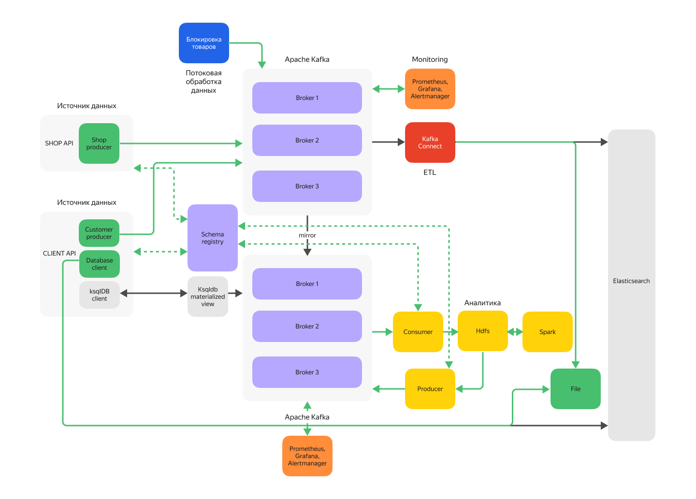
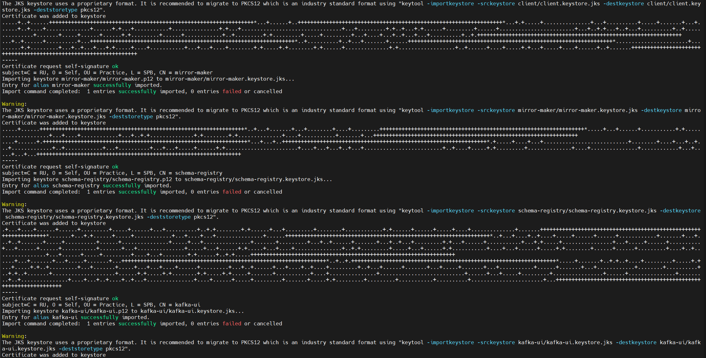
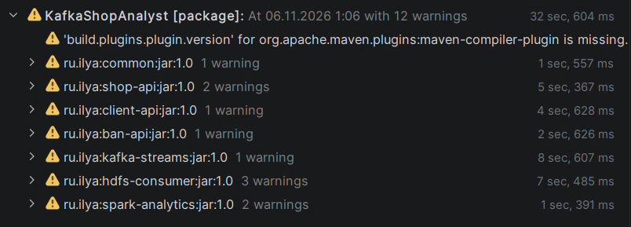
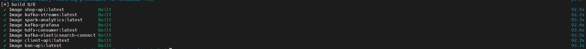
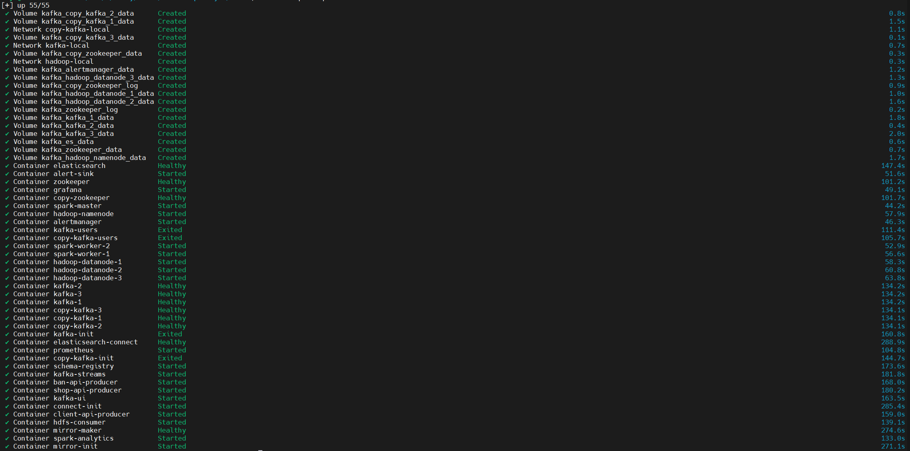
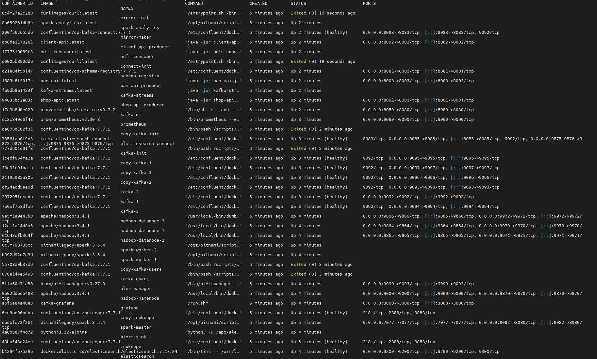
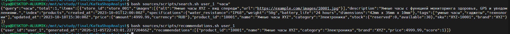

# KafkaShopAnalyst

Аналитическая платформа для маркетплейса. Проект собирает события о товарах и действиях клиентов, проводит их через Kafka, фильтрует запрещённые товары, складывает данные в HDFS и Elasticsearch, считает рекомендации в Spark и отдаёт их обратно в Kafka.

## Содержание

- [Архитектура](#архитектура)
- [Технологии](#технологии)
- [Структура репозитория](#структура-репозитория)
- [Начало работы](#начало-работы)
- [Порты и UI](#порты-и-ui)
- [Демо-сценарий](#демо-сценарий)
- [Как это устроено](#как-это-устроено)
- [Мониторинг](#мониторинг)
- [Пайплайн верификации](#пайплайн-верификации)
- [Остановка и сброс](#остановка-и-сброс)
- [Возможные проблемы](#возможные-проблемы)
- [Текущий статус и ограничения](#текущий-статус-и-ограничения)
- [Безопасность](#безопасность)

## Архитектура



Упрощённо:

Полная схема — на рисунке [`Схема.png`](docs/scheme.png).

```text
SHOP API   -> raw-product-topic    -> Kafka Streams -> filtered-product-topic -> Kafka Connect -> Elasticsearch
BAN API    -> banned-product-topic -> Kafka Streams (таблица запретов)
CLIENT API -> user-query-topic     -> Kafka main -> MirrorMaker 2 -> Kafka copy -> HDFS -> Spark -> analyst-topic -> CLIENT API
CLIENT API -> Elasticsearch (поиск)
```

### Поток данных

1. **SHOP API** читает `sources/data/products.json` и отправляет товары в `raw-product-topic`.
2. **CLIENT API** отправляет поисковые запросы и запросы рекомендаций в `user-query-topic`, ищет товары в Elasticsearch и читает готовые рекомендации из `analyst-topic` второго кластера.
3. **BAN API** добавляет и снимает запреты через `banned-product-topic` (снятие через tombstone).
4. **Kafka Streams** держит таблицу запретов и пропускает в `filtered-product-topic` только разрешённые товары. При бане в `filtered-product-topic` отправляется tombstone, чтобы Kafka Connect удалил товар из Elasticsearch.
5. **Kafka Connect Elasticsearch Sink** пишет `filtered-product-topic` в индекс `filtered-product-topic`.
6. **MirrorMaker 2** переносит `user-query-topic` и `filtered-product-topic` во второй кластер.
7. **hdfs-consumer** читает второй кластер и пишет JSONL-конверты в HDFS:
   - `/data/raw/products`
   - `/data/raw/queries`
8. **Spark Structured Streaming** следит за `/data/raw/queries`, пересчитывает рекомендации по всем товарам и запросам и пишет их в `analyst-topic` второго кластера.
9. **Prometheus + JMX Exporter + Grafana + Alertmanager** собирают и визуализируют метрики брокеров и Kafka Connect.

### Основные топики

| Топик | Кластер | Назначение                         |
|---|---|------------------------------------|
| `raw-product-topic` | main | Товары от SHOP API                 |
| `banned-product-topic` | main | Запреты товаров                    |
| `filtered-product-topic` | main | Разрешённые товары для Connect/HDFS |
| `user-query-topic` | main | Поисковые запросы клиентов         |
| `analyst-topic` | copy | Рекомендации Spark      |
| `schemas` | main | Schema Registry             |

## Технологии

| Компонент | Версия / реализация |
|---|---|
| Java | 17 |
| Maven | 3.8+ |
| Kafka / Confluent Platform | 3.9 clients / 7.7.1 |
| Kafka Streams | 3.9.0 |
| Kafka Connect + Elasticsearch Connector | 14.1.0 |
| MirrorMaker 2 | cp-kafka-connect 7.7.1 |
| Schema Registry | 7.7.1 |
| Hadoop HDFS | 3.4.1 |
| Apache Spark | 3.5.4 |
| Elasticsearch | 7.17.24 |
| Prometheus | 2.30.3 |
| Grafana | 8.1.6 |
| Alertmanager | 0.27.0 |
| JMX Exporter | 0.15.0 |
| Docker Compose | v2 |

## Структура репозитория

```text
.
├── common/                       # модели и JSON-сериализация
├── sources/
│   ├── shop-api/                 # магазин товаров
│   ├── client-api/               # поиск и запросы рекомендаций
│   ├── ban-api/                  # управление запретами
│   ├── data/products.json        # исходные товары
│   └── scripts/                  # скрипты демо и проверки
├── kafka-streams/                # фильтрация запрещённых товаров
├── analytics/
│   ├── hdfs-consumer/            # Kafka -> HDFS
│   └── spark-analytics/          # HDFS -> рекомендации в Kafka
├── kafka/
│   ├── docker-compose.yml        # основной стенд
│   ├── .env.example              # шаблон конфигурации
│   ├── scripts/                  # сертификаты, пользователи, топики, ACL
│   ├── certs-config/             # конфиги OpenSSL
│   ├── mirror-maker/config.json  # MirrorMaker 2
│   └── monitoring/               # Prometheus/Grafana/Alertmanager
├── hadoop/                       # конфиги NameNode/DataNode
├── elasticsearch-connect/        # Dockerfile и конфиг ES Sink
├── docs/                        # скриншоты для README
├── Схема.png
```

## Начало работы

### Требования

- Docker Engine и Docker Compose v2;
- Java 17 и Maven 3.8+;
- `openssl` и `keytool` (для генерации сертификатов);
- `curl` и `python3` (для скриптов проверки);
- желательно 8+ ГБ RAM (стенд тяжёлый: 3 + 3 брокера, Hadoop, Spark, Elasticsearch), у меня занял 13 Гб RAM. 

### 1. Конфигурация

```bash
cp kafka/.env.example kafka/.env
```

При необходимости поменяйте пароли в `kafka/.env`. После смены `CERT_PASSWORD` сертификаты нужно пересоздать.

### 2. Сертификаты

```bash
cd kafka
bash scripts/generate-certs.sh
cd ..
```

Скрипт создаёт `kafka/secrets/`: CA, keystore/truststore для брокеров и клиентов, JAAS-конфиги и `admin.properties`. Каталог `secrets/` в `.gitignore`.



### 3. Сборка

```bash
mvn clean package
```

Docker-образы приложений копируют уже собранные jar из `target/`, поэтому Maven должен отработать до `docker compose build`.



### 4. Запуск

Можно предварительно собрать образы:

```bash
cd kafka
docker compose build
```



Либо сразу собрать и запустить:

```bash
cd kafka
docker compose up -d --build
```



Первый запуск занимает несколько минут: Hadoop форматирует NameNode, Grafana выполняет миграции, Kafka создаёт топики и ACL.

Проверка:

```bash
docker compose ps -a
```

Ожидаемо:
- брокеры `healthy`;
- `kafka-init`, `copy-kafka-init`, `kafka-users`, `copy-kafka-users`, `connect-init`, `mirror-init` завершились с кодом 0;
- `spark-analytics`, `kafka-streams`, `hdfs-consumer`, `prometheus`, `grafana`, `alertmanager` — `Up`.



### 5. Первый запуск аналитики

Загрузите товары:

```bash
bash sources/scripts/load_products.sh
```

Spark-job работает в фоне и ждёт появления файлов в HDFS. После первых запросов клиентов рекомендации появятся в `analyst-topic`; CLIENT API читает их из второго кластера и отдаёт через `/api/recommendations`.

## Порты и UI

| Сервис | Адрес |
|---|---|
| SHOP API | http://localhost:8001 |
| CLIENT API | http://localhost:8002 |
| BAN API | http://localhost:8003 |
| Kafka UI | http://localhost:8080 |
| Schema Registry | http://localhost:8081 |
| Spark Master UI | http://localhost:8082 |
| MirrorMaker Connect REST | http://localhost:8083 |
| Elasticsearch Connect REST | http://localhost:8085 |
| Elasticsearch | http://localhost:9200 |
| Prometheus | http://localhost:9090 |
| Grafana | http://localhost:3000 |
| Alertmanager | http://localhost:9099 |
| HDFS NameNode UI | http://localhost:9870 |
| HDFS DataNode UI | 9864, 9865, 9866 |
| Kafka external listeners | 9092, 9093, 9094 (main); 9095, 9096, 9097 (copy) |

Grafana по умолчанию: `admin` / `admin`. Смените пароль после первого входа.

## Демо-сценарий

```bash
# 1. Загрузить товары из файла
bash sources/scripts/load_products.sh

# 2. Поиск товара клиентом
bash sources/scripts/search.sh user_1 "часы"

# 3. Сгенерировать активность клиентов
bash sources/scripts/client_activity.sh 20

# 4. Забанить / разбанить товар
bash sources/scripts/ban_product.sh 10005 "запрещено вручную"
bash sources/scripts/unban_product.sh 10005

# 5. Получить рекомендации (после того как Spark обработает запросы; ~30-60 с)
bash sources/scripts/recommendations.sh user_1
```



Запросы клиентов попадают в `user-query-topic`, зеркалируются во второй кластер, `hdfs-consumer` пишет их в HDFS, а Spark пересчитывает рекомендации.

Посмотреть рекомендации в Kafka:

```bash
docker exec copy-kafka-1 \
  env -u KAFKA_OPTS -u KAFKA_JMX_PORT \
  kafka-console-consumer \
  --bootstrap-server copy-kafka-1:29092 \
  --consumer.config /etc/kafka/jaas/admin.properties \
  --topic analyst-topic \
  --from-beginning --max-messages 5 --timeout-ms 10000 \
  --property print.key=true --property key.separator=' => '
```

> `env -u KAFKA_OPTS -u KAFKA_JMX_PORT` обязателен для CLI внутри брокера: иначе JVM попытается повторно поднять JMX-агент на занятом порту.

## Как это устроено

### SHOP API, CLIENT API, BAN API

- Все три сервиса — лёгкие HTTP-серверы на JDK `HttpServer`.
- Конфигурация читается из переменных окружения (Docker) или `application.properties` (локальный запуск).
- Продюсеры используют `SASL_SSL`, `SCRAM-SHA-512`, `acks=all`.
- SHOP API читает `sources/data/products.json`; файл хранится в Git.
- CLIENT API:
  - `/api/search` — отправляет запрос в Kafka и ищет товары в Elasticsearch (`multi_match` по имени, описанию, бренду, категории и тегам); без `user_id` возвращает `400`;
  - `/api/recommendations` — отправляет запрос в Kafka и отдаёт последнюю рекомендацию из `analyst-topic` второго кластера. Чтение выполняет фоновый `KafkaAnalystConsumer`: consumer group с префиксом `client-api-group` и уникальным суффиксом на инстанс, `auto.offset.reset=earliest` (при старте кэш заполняется из истории топика), кэш `user_id -> JSON` в `ConcurrentHashMap`;
  - если `user_id` не передан — `400`; если рекомендаций для пользователя нет — `404` с JSON-ошибкой;
  - на copy-кластере пользователю `customer-producer` выдан read ACL на `analyst-topic`.
- BAN API:
  - `POST /api/bans` — добавить запрет;
  - `DELETE /api/bans/{product_id}` — снять запрет (tombstone в compacted-топик).

> **Ограничение рекомендаций:** если товар попал в HDFS до того, как его забанили, он может остаться в рекомендациях. Это осознанное ограничение текущей реализации: приложение не удаляет исторические данные и не фильтрует рекомендации постфактум. Для очистки используйте сброс HDFS из раздела [«Остановка и сброс»](#остановка-и-сброс).

### Kafka: TLS, ACL, репликация, mirror

- 3 брокера в основном кластере и 3 во втором.
- Включены TLS и SASL/SCRAM-SHA-512; клиентская аутентификация обязательна.
- Репликация: `replication.factor=3`, `min.insync.replicas=2`, `auto.create.topics.enable=false`.
- Пользователи создаются в `kafka/scripts/create-users.sh` и `create-copy-users.sh`.
- Топики и ACL — в `init-topics-acl.sh` и `init-copy-topics-acl.sh`.
- MirrorMaker 2 конфигурируется в `kafka/mirror-maker/config.json` и переносит `user-query-topic` и `filtered-product-topic`.
- Schema Registry развёрнут, но в текущей версии не используется продюсерами (задел на Avro/JSON Schema).

### Kafka Streams

Топология в `kafka-streams/src/main/java/kafka/KafkaStreamProcessor.java`:

- `KTable<String, BannedProduct>` по `banned-product-topic`;
- `leftJoin` потока товаров с таблицей запретов по `product_id`;
- запрещённые товары не попадают в `filtered-product-topic`;
- при событии бана в `filtered-product-topic` отправляется tombstone, чтобы Kafka Connect удалил документ из Elasticsearch;
- tombstone от снятия бана не отправляется, чтобы не удалить товар, который мог быть только что переиндексирован.

### Kafka Connect и Elasticsearch

- Коннектор: `io.confluent.connect.elasticsearch.ElasticsearchSinkConnector`.
- Конфиг: `elasticsearch-connect/connector-config.json`.
- Индекс: `filtered-product-topic`; ключ Kafka используется как `_id`.
- `behavior.on.null.values=delete` — удаление документа по tombstone.

### HDFS и Spark

`hdfs-consumer`:

- читает `filtered-product-topic` и `user-query-topic` из второго кластера;
- пишет JSONL-файлы с конвертом `topic`, `partition`, `offset`, `key`, `timestamp`, `value`;
- коммитит offset после записи файла;
- атомарно пишет во временный файл и переименовывает.

`spark-analytics`:

- Structured Streaming читает `/data/raw/queries`;
- на каждый новый файл (`Trigger.ProcessingTime("30 seconds")`) делает полный пересчёт по всем товарам и запросам;
- токенизирует поисковые запросы, сопоставляет с названием, описанием, категорией, брендом и тегами;
- считает score и top-5 товаров на пользователя;
- пишет JSON в `analyst-topic` с ключом `user_id`;
- checkpoint: `/data/checkpoints/recommendations`;
- топик `analyst-topic` имеет `cleanup.policy=compact,delete`, поэтому хранится последняя рекомендация на пользователя.

## Мониторинг

- **Prometheus** — `http://localhost:9090`, конфиг `kafka/monitoring/prometheus/prometheus.yml`, правила `alerts.yml`.
- **Grafana** — `http://localhost:3000`; дашборд **Kafka Brokers** (`kafka/monitoring/grafana/dashboards/kafka-brokers.json`). Переменная `cluster` переключает `kafka` / `copy-kafka`.
- **Alertmanager** — `http://localhost:9099`; конфиг `kafka/monitoring/alertmanager/alertmanager.yml`.
- **JMX Exporter**:
  - брокеры — `kafka/monitoring/agent/kafka.yml`, порт `9876`;
  - Kafka Connect — `kafka/monitoring/agent/kafka-connect.yml`, порт `9876`.

Дашборд показывает:
- количество живых брокеров;
- under-replicated / offline / under-min-ISR partitions;
- активный контроллер;
- messages in, bytes in/out, produce/fetch RPS;
- ISR shrink/expand;
- размер логов;
- JVM heap и GC;
- network processor idle и request queue;
- p99 latency.

Алерты:
- `KafkaBrokerDown` — брокер не скрейпится > 30s;
- `KafkaUnderReplicatedPartitions` — есть under-replicated partitions;
- `KafkaOfflinePartitions` — есть партиции без лидера;
- `KafkaUnderMinIsrPartitions` — партиции ниже `min.insync.replicas`;
- `KafkaNoActiveControllerMain` / `KafkaNoActiveControllerCopy` — нет ровно одного активного контроллера.

Уведомления по умолчанию принимает контейнер `alert-sink` и пишет их в лог:

```bash
docker compose logs -f alert-sink
```

Проверка цепочки Alertmanager без остановки брокера:

```bash
docker exec alertmanager \
  amtool --alertmanager.url=http://localhost:9093 \
  alert add alertname=TestAlert severity=warning 'summary="test alert"'

docker compose logs --tail=10 alert-sink
```

## Пайплайн верификации

Скрипт `sources/scripts/verify_pipeline.sh` проверяет сквозной сценарий: SHOP API -> Kafka Streams -> Kafka Connect -> Elasticsearch -> CLIENT API.

### Что нужно

- поднятый стенд: брокеры healthy, SHOP/CLIENT/BAN API отвечают;
- `curl` и `python3` в `PATH`;
- файл `sources/data/products.json` (15 товаров);
- 
### Запуск

Из корня проекта:

```bash
bash sources/scripts/verify_pipeline.sh
```

Скрипт сам определяет пути к `products.json` и `connector-config.json`. Первый запуск может занять 1–2 минуты: он ждёт Elasticsearch и регистрацию Kafka Connect.

### Что проверяет

1. Доступность SHOP/CLIENT/BAN API, Elasticsearch и Kafka Connect.
2. Регистрирует/перезапускает ES-коннектор и ждёт состояние `RUNNING` у коннектора и его tasks.
3. Очищает индекс `filtered-product-topic`.
4. Добавляет запреты на `10005`, `10009`, `10013`.
5. Загружает 15 товаров через SHOP API.
6. Ждёт, пока в Elasticsearch появится 12 разрешённых товаров.
7. Проверяет, что разрешённый товар находится поиском, а забаненный — отсутствует.

Ожидаемый финал:

```text
[OK]   В Elasticsearch 12 документов
[OK]   Разрешённый товар найден
[OK]   Забаненный товар в поиске отсутствует
[OK]   Проверка пройдена: фильтрация, запись в Elasticsearch и поиск работают.
```

При ошибке скрипт печатает `[FAIL]` и завершается с ненулевым кодом.

### Побочные эффекты

- Индекс `filtered-product-topic` очищается.
- Баны `10005`, `10009`, `10013` остаются в Kafka; повторный запуск идемпотентен. Снять вручную: `bash sources/scripts/unban_product.sh <product_id>`.
- HDFS и `analyst-topic` скрипт не очищает; рекомендации он не проверяет. Для рекомендаций используйте `bash sources/scripts/recommendations.sh user_1` после появления данных в `analyst-topic`.

### Ручная проверка

```bash
bash sources/scripts/search.sh user_1 "часы"
bash sources/scripts/recommendations.sh user_1
```

`recommendations.sh` вернёт `404`, если Spark ещё не записал рекомендации для пользователя; подождите батч (до 30 секунд + время выполнения) или проверьте `analyst-topic`.

## Остановка и сброс

Остановить стенд без удаления данных:

```bash
cd kafka
docker compose down
```

Полный сброс (удаляет тома Kafka/HDFS/ES):

```bash
cd kafka
docker compose down -v
```

## Возможные проблемы

### Брокеры unhealthy после добавления JMX

Healthcheck запускает `kafka-broker-api-versions` как отдельный JVM и наследует `KAFKA_OPTS` с JMX-агентом. Агент пытается занять уже занятый порт `9876` и процесс падает. В compose healthcheck специально запускается так:

```yaml
env -u KAFKA_OPTS -u KAFKA_JMX_PORT kafka-broker-api-versions ...
```

Не убирайте `env -u ...`. То же правило действует для `kafka-acls`, `kafka-topics`, `kafka-console-consumer` и других CLI внутри контейнера брокера.

### `shop-api` не публикует порт 8001

Если порт был занят при первом `docker compose up`, контейнер мог остаться в некорректном состоянии. Пересоздайте его:

```bash
cd kafka
docker compose up -d --force-recreate --no-deps shop-api-producer
```

Также проверьте, не висит ли локальный Java-процесс на `8001`.

### Kafka Streams: `Topic ... has already been registered by another source`

Нельзя одновременно читать один топик как `GlobalKTable` и как второй `KStream` в одной топологии. В проекте используется `KTable` + `toStream()` — не добавляйте второй source на `banned-product-topic`.

### Spark не пишет рекомендации

- Проверьте, что `hdfs-consumer` пишет файлы: `hdfs dfs -ls -R /data/raw`.
- Проверьте, что запросы имеют `type=SEARCH` и непустой `query`.
- Проверьте checkpoint: `hdfs dfs -ls -R /data/checkpoints/recommendations`.
- Если менялась логика, удалите checkpoint и перезапустите `spark-analytics`.
- Логи `spark-analytics` могут не показывать `log.info` из-за `setLogLevel("WARN")`; это не ошибка.

### CLIENT API возвращает 404 или 400

- `400` — в запросе нет `user_id`.
- `404` — для пользователя ещё нет рекомендаций.
- Проверьте, что в `analyst-topic` есть сообщения (команда `kafka-console-consumer` из [демо](#демо-сценарий)).
- Проверьте, что `client-api` подключён к `copy-kafka-local`, а пользователь `customer-producer` создан на copy-кластере и имеет read ACL на `analyst-topic` (`create-copy-users.sh`, `init-copy-topics-acl.sh`).
- Проверьте логи: `docker logs client-api-producer | grep "Получена рекомендация"`.
- У пользователя должен быть хотя бы один SEARCH-запрос; Spark пересчитывает рекомендации раз в 30 секунд.
- Если товар был забанен после записи в HDFS, он может остаться в рекомендациях — см. [ограничения](#текущий-статус-и-ограничения).

### Compose не видит переменные окружения

Запускайте compose из каталога `kafka`, где лежит `.env`:

```bash
cd kafka
docker compose up -d
```
